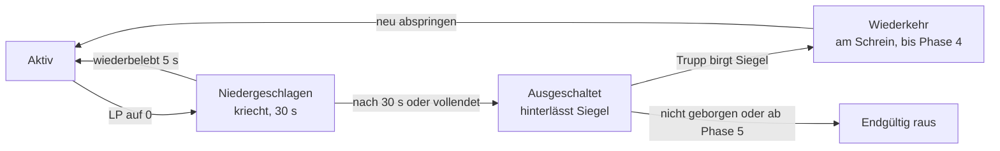

# Battle of the Storm – Game Design Document

> Quelle: [Claude Doc](https://claude.ai/artifact/4qG6b8Q5nHg9knqsW4VPDN) · Diese Datei ist eine synchronisierte Kopie. Änderungen bitte im Claude Doc vornehmen.

## Versionierung

Aktuelle Version: 0.4. Jede inhaltliche Änderung an diesem Dokument wird hier festgehalten. Das gilt für Menschen und für Agents.

**Regeln**

1. Vor dem Speichern einer Änderung eine neue Zeile oben in die Tabelle eintragen: Version, Datum, Autor, Änderung mit betroffenen Abschnitten.
2. Versionsnummer: zweite Stelle erhöhen bei Ergänzungen und Wertänderungen (0.3 → 0.4), erste Stelle bei Änderungen an Grundsatzentscheidungen (Genre, Modus, Design-Säulen).
3. „Aktuelle Version“ in der Zeile über diesen Regeln anpassen.
4. Reine Tippfehler-Korrekturen brauchen keinen Eintrag.
5. Nach jeder Änderung die Kopien abgleichen: `docs/GDD.md` im Repository und `/Battle of the Storm/GDD.md` in Dropbox. Quelle ist das Claude Doc.

| Version | Datum | Autor | Änderung |
| --- | --- | --- | --- |
| 0.4 | 2026-11-12 | Claude, im Auftrag von Florian | Engine entschieden: Unreal Engine 5. Heldenzugang entschieden: freie Rotation, Kauf mit Spielwährung oder Echtgeld (Abschnitte 2, 12, 14, 16) |
| 0.3 | 2026-11-12 | Claude, im Auftrag von Florian | Versionierung eingeführt |
| 0.2 | 2026-11-12 | Claude, im Auftrag von Florian | Tastenbelegung geändert: Fähigkeiten auf 1 bis 5, Aktivgegenstände auf Q und E (Abschnitte 6, 9, 16) |
| 0.1 | 2026-11-12 | Claude, im Auftrag von Florian | Erste Fassung |

## 1. Überblick

Battle of the Storm ist ein Top-Down-Battle-Royale für Trupps à 4 Spieler: Teams wählen Helden mit festen Rollen und Fähigkeiten, landen auf einer großen Karte und kämpfen, bis ein Trupp übrig ist. Ein Sturm zieht die spielbare Fläche in Phasen zusammen.

**Pitch:** MOBA-Helden mit Rollen und Talentwahl treffen auf das schnelle, harte Tempo eines modernen Battle-Royale.

### Design-Säulen

1. **Rolle vor Ausrüstung.** Der gewählte Held bestimmt das Spiel. Loot verstärkt, ersetzt aber keine Rolle.
2. **Trupp gewinnt, nicht der Einzelne.** Geteilte Trupp-Erfahrung, Synergien zwischen Rollen, Wiederbelebung.
3. **Hohes Tempo.** Kurze Wege zum ersten Kampf, kurze Matches (Ziel: 18 bis 22 Minuten), wenig Leerlauf.
4. **Der Sturm ist ein Akteur.** Er schrumpft nicht nur, er verändert die Karte und erzeugt Ereignisse.
5. **Lesbarkeit.** Jede Fähigkeit ist aus der Top-Down-Perspektive eindeutig erkennbar.

### Herkunft der Elemente

| Bereich | Vorbild | Übernommen wird |
| --- | --- | --- |
| Helden, Rollen, Fähigkeiten | Heroes of the Storm | Systematik: Rollen-Kategorien, Fähigkeiten-Slots, Talentwahl auf festen Stufen, geteilte Team-Erfahrung |
| Spielmodus, Tempo | REDSEC | Battle-Royale-Struktur mit Trupps, schrumpfende Zone, hohes Tempo, Aufträge während des Matches |
| Zone | eigene Idee | Sturm statt Feuer |

**Abgrenzung:** Übernommen werden nur Mechaniken und Genre-Konventionen. Alle Helden, Namen, Fähigkeiten, Karten, Lore und der visuelle Stil sind eigenständig. Keine Figuren, Namen oder Assets aus den Vorbildern.

## 2. Zielgruppe und Rahmendaten

Zielgruppe sind Spieler mit MOBA-Erfahrung, die kürzere Matches wollen, und Battle-Royale-Spieler, die taktische Tiefe über Helden suchen.

| Merkmal | Festlegung | Status |
| --- | --- | --- |
| Genre | Top-Down-Battle-Royale mit Helden | fest |
| Perspektive | Isometrisch/Top-Down, feste Kamera | fest |
| Trupp | 4 Spieler | Vorschlag |
| Spieler pro Match | 60 (15 Trupps) | Vorschlag, abhängig von Technik |
| Matchdauer | 18 bis 22 Minuten | Ziel |
| Plattform | PC (Maus/Tastatur) zuerst | Vorschlag |
| Geschäftsmodell | Free-to-Play; kaufbar sind Helden und Kosmetik | fest |
| Altersfreigabe | Fantasy-Gewalt, Ziel USK 12 / PEGI 12 | Annahme |

## 3. Spielmodus und Match-Ablauf

Sieger ist der letzte Trupp mit mindestens einem lebenden Mitglied. Ein Match läuft in fünf Phasen.

1. **Heldenwahl (60 s).** Jeder Spieler wählt einen Helden. Innerhalb eines Trupps ist jeder Held nur einmal erlaubt. Zwischen Trupps sind Duplikate erlaubt.
2. **Absprung (ca. 60 s).** Der Trupp fliegt in einem Sturmgleiter über die Karte. Jeder Spieler wählt seinen Landepunkt selbst, mit Option „Truppführer folgen“.
3. **Frühe Phase (Level 1 bis 7).** Ausrüstung sammeln, Lager neutraler Kreaturen räumen, erste Aufträge, erste Kämpfe.
4. **Mittlere Phase (Level 8 bis 15).** Ultimative Fähigkeit freigeschaltet. Sturm-Ereignisse beginnen. Trupps ziehen um Kontrollpunkte und Sturmkerne.
5. **Endphase (Level 16 bis 20).** Kleine Zone, keine Wiederkehr mehr, Entscheidungskampf.

### Core Loop

Landen → Loot und XP sammeln → Level und Talente → Kämpfen oder ausweichen → Sturm folgen → wiederholen.

### Aufträge

Während des Matches erscheinen zeitlich begrenzte Aufträge für einzelne Trupps, zum Beispiel „Halte Punkt X 45 s lang“ oder „Besiege den Wächter in Gebiet Y“. Belohnung: Trupp-XP, Ausrüstung oder ein Wiederkehr-Signal (siehe Abschnitt 10). Ziel: Trupps aktiv in Kontakt bringen statt Camping zu belohnen.

## 4. Sturm-System

Der Sturm schließt die Karte in 7 Phasen und rund 19 Minuten bis auf null. Die nächste sichere Zone („Auge“) wird zu Beginn jeder Wartezeit auf der Karte angezeigt.

### Phasen (Startwerte, Karte 1.200 × 1.200 m)

| Phase | Wartezeit (s) | Schrumpfen (s) | Durchmesser danach (m) | Schaden pro s (% max. LP) |
| --- | --- | --- | --- | --- |
| 1 | 180 | 120 | 800 | 1 |
| 2 | 150 | 90 | 520 | 2 |
| 3 | 120 | 75 | 320 | 3 |
| 4 | 90 | 60 | 180 | 5 |
| 5 | 60 | 45 | 90 | 8 |
| 6 | 45 | 40 | 40 | 12 |
| 7 | 30 | 30 | 0 | 20 |

Schaden in Prozent der maximalen Lebenspunkte, damit er unabhängig von Held und Level gleich wirkt.

### Wirkung im Sturm

- Sichtweite halbiert.
- Keine Lebensregeneration, Heilung um 50 % reduziert.
- Wiederbelebung im Sturm dauert doppelt so lange.

### Sturm-Ereignisse (ab Phase 2)

| Ereignis | Wirkung | Gegenspiel |
| --- | --- | --- |
| Blitzfeld | Markierte Kreise außerhalb des Auges, nach 2 s Einschlag mit hohem Schaden | Markierung verlassen |
| Sturmfront | Ein Kartensektor wird für 30 s Teil des Sturms, bevor die Zone dort ankommt | Frühe Warnung, 10 s Vorlauf |
| Sturmkern | Neutrales Objekt; der Trupp, der es 20 s hält, erhält 30 s Sturmimmunität und sieht das übernächste Auge | Andere Trupps werden beim Start der Einnahme benachrichtigt |
| Windschneise | Tempo-Zone: +40 % Bewegung in Windrichtung | Sichtbar, nutzbar für Flucht und Angriff |

## 5. Rollen und Helden

Sechs Rollen, zum Start zwei Helden pro Rolle, also 12 Helden. Rollenpflicht im Trupp gibt es nicht; das Spiel zeigt bei der Heldenwahl nur fehlende Rollen an.

### Rollen

| Rolle | Aufgabe im Trupp | Lebenspunkte | Schaden | Mobilität |
| --- | --- | --- | --- | --- |
| Tank | Kampf eröffnen, Schaden abfangen, Gegner kontrollieren | sehr hoch | niedrig | mittel |
| Kämpfer | Frontlinie halten, anhaltender Nahkampfschaden | hoch | mittel | mittel |
| Heiler | Trupp am Leben halten, schnellere Wiederbelebung | niedrig | niedrig | mittel |
| Unterstützer | Sicht, Schilde, Kontrolle, Zonenmanipulation | mittel | niedrig | mittel |
| Fernkampf-Assassine | Schaden aus Distanz | niedrig | hoch | niedrig |
| Nahkampf-Assassine | Ziele isolieren und ausschalten | niedrig | hoch | hoch |

### Startroster

Alle Helden, Namen und Kits sind Platzhalter-Entwürfe und eigenständig.

| Held | Rolle | Konzept | Merkmal (passiv) | Ultimative Fähigkeit (Wahl auf Level 8) |
| --- | --- | --- | --- | --- |
| Kordo | Tank | Steinkoloss aus einem eingestürzten Gebirge | Bei Treffern sammelt er Geröll, das als Schild verbraucht wird | Erdrutsch (Linie, schleudert Gegner zurück) oder Monolith (unzerstörbare Wand für 4 s) |
| Ysra | Tank | Schildwächterin eines Leuchtturm-Ordens | Verbündete hinter ihr erleiden 15 % weniger Schaden | Leuchtfeuer (zieht Gegner im Kreis zu ihr) oder Bastion (Trupp 3 s unverwundbar, sie selbst nicht) |
| Varg | Kämpfer | Wolfsreiter der Steppe | Jeder dritte Angriff verursacht Blutung | Rudelruf (zwei Wolfsgeister jagen 8 s) oder Hetzjagd (markiert Ziel, +50 % Tempo zu ihm) |
| Tamsin | Kämpfer | Schmiedin mit Kettenhammer | Treffer mit Fähigkeiten erhitzen den Hammer, bei voller Hitze Flächenschaden | Glutkern (verwandelt Boden in Lava) oder Amboss (Betäubung im Zielkreis nach 1 s) |
| Elowen | Heiler | Wetterpriesterin, heilt mit Regen | Heilung auf Ziele unter 30 % LP ist 25 % stärker | Wolkenbruch (Flächenheilung 5 s) oder Regenbogenpfad (Trupp teleportiert zu ihr) |
| Mabeth | Heiler | Kräuterhexe mit Raben | Wiederbelebung durch sie ist 40 % schneller | Rabenschwarm (Gegner im Bereich geblendet) oder Zweites Leben (verhindert einmal einen Niederschlag) |
| Orrin | Unterstützer | Nebelweber, manipuliert Sicht | Sieht Gegner im Sturm mit voller Sichtweite | Nebelbank (große Fläche, Trupp unsichtbar darin) oder Fata Morgana (Trugbilder aller Truppmitglieder) |
| Lysa | Unterstützer | Ingenieurin mit Windgeneratoren | Kann Windschneisen kurz verstärken oder umkehren | Zyklon (wandernder Wirbel, wirft Gegner hoch) oder Windmauer (blockiert Projektile 5 s) |
| Sefa | Fernkampf-Assassine | Blitzschützin, nutzt Sturmenergie | Im Sturm +20 % Angriffsgeschwindigkeit | Kettenblitz (springt auf 5 Ziele) oder Gewitterzelle (Zone, Blitze alle 0,5 s) |
| Halvard | Fernkampf-Assassine | Kanonier mit Mehrfachgeschossen | Gezielte Schüsse aus dem Stand verursachen +30 % Schaden | Langrohr (Schuss über halbe Karte) oder Sperrfeuer (Flächenbeschuss 4 s) |
| Kiro | Nahkampf-Assassine | Klingentänzer, Kombo-orientiert | Nach einer Fähigkeit ist der nächste Angriff kritisch | Tausend Schnitte (8 Treffer, unanwählbar) oder Spiegelschritt (Platztausch mit Ziel) |
| Ilka | Nahkampf-Assassine | Schattenjägerin | Unsichtbar außerhalb des Kampfes nach 3 s Stillstand | Schattenfalle (Ziel 2 s festgehalten) oder Exekution (Hinrichtung unter 20 % LP, Abklingzeit zurück bei Erfolg) |

## 6. Fähigkeiten-Systematik

Jeder Held hat dieselben Slots; die Stärke wächst über Talente, nicht über neue Grundfähigkeiten.

### Slots

| Slot | Taste | Verfügbar ab | Inhalt |
| --- | --- | --- | --- |
| Basisangriff | Linke Maustaste | Level 1 | Nah- oder Fernkampf, heldenabhängig |
| Fähigkeit 1 bis 3 | 1, 2, 3 | Level 1 | Kern-Kit des Helden, Abklingzeit 4 bis 16 s |
| Merkmal | 5 | Level 1 | Passiv oder aktiv mit langer Abklingzeit |
| Ultimative Fähigkeit | 4 | Level 8 | Eine von zwei Optionen, Abklingzeit 60 bis 120 s |
| Sturmlauf | Z | Level 1 | Fortbewegung: +40 % Tempo nach 1 s Kanalisieren, endet bei Schaden |
| Aktivgegenstand | Q, E | Fund | Gegenstände aus dem Loot (siehe Abschnitt 7) |

### Ressource

Standard ist Mana mit langsamer Regeneration. Einzelne Helden nutzen eigene Ressourcen (z. B. Hitze bei Tamsin, Geröll bei Kordo). Mana-Tränke gibt es im Loot.

### Talente

Auf 7 Stufen wählt der Spieler je ein Talent aus 3 Optionen (Ultimative Fähigkeit: 2 Optionen). Talente verändern Fähigkeiten, statt nur Werte zu erhöhen.

| Talentstufe | Level | Typischer Inhalt |
| --- | --- | --- |
| 1 | 1 | Ausrichtung des Spielstils |
| 2 | 4 | Verstärkung einer Grundfähigkeit |
| 3 | 8 | Wahl der Ultimativen Fähigkeit |
| 4 | 11 | Überleben oder Mobilität |
| 5 | 14 | Kombos und Synergien |
| 6 | 17 | Spezialisierung |
| 7 | 20 | Verbesserung der Ultimativen Fähigkeit oder Sturm-Talent |

**Sturm-Talente** sind allgemeine Talente auf Stufe 7, die mit dem Sturm interagieren, zum Beispiel 50 % weniger Sturmschaden oder Heilung beim Betreten des Auges.

## 7. In-Match-Progression

Jeder Trupp teilt sich ein Level (1 bis 20). Ausrüstung ergänzt das Level, ein guter Fund ersetzt aber keine 3 Level Rückstand.

### Trupp-Erfahrung

| Quelle | Anteil am XP-Gewinn (Ziel) | Hinweis |
| --- | --- | --- |
| Lager neutraler Kreaturen | 35 % | Drei Größen, Respawn nur in Phase 1 und 2 |
| Gegnerische Helden besiegen | 30 % | Wert steigt mit dem Level des Besiegten |
| Aufträge | 20 % | Siehe Abschnitt 3 |
| Sturmkerne und Truhen | 15 % |  |

Aufholmechanik: Besiegt ein Trupp einen Trupp mit höherem Level, erhält er pro Level Unterschied 15 % Bonus-XP.

### Ausrüstung

Keine Waffen. Jeder Held trägt bis zu 3 **Relikte** (passiv) und 2 **Aktivgegenstände**.

| Typ | Slots | Beispiele | Seltenheit |
| --- | --- | --- | --- |
| Relikt: Angriff | 1 | +Schaden, +Angriffstempo, -Abklingzeit | Gewöhnlich, Selten, Episch, Legendär |
| Relikt: Verteidigung | 1 | +LP, Schild beim Kampfbeginn, -Kontrolldauer | wie oben |
| Relikt: Nutzen | 1 | +Tempo, größere Sicht, schnellere Wiederbelebung | wie oben |
| Aktivgegenstand | 2 | Heiltrank, Schildphiole, Rauchbombe, Sturmanker (Teleport zu einem markierten Punkt) | Gewöhnlich bis Selten |

Legendäre Relikte haben einen einzigartigen Effekt und gibt es nur aus Sturmkernen, Aufträgen und Elite-Lagern.

### Sturmsplitter

Währung im Match aus Truhen, Lagern und besiegten Gegnern. Einsatz an Schreinen: Relikt um eine Seltenheitsstufe verbessern oder Wiederkehr-Signal kaufen.

## 8. Karte

Die Startkarte „Sturmbruch“ ist eine Insel von 1.200 × 1.200 m mit 5 Biomen und 12 benannten Orten. Ein Held überquert sie mit Sturmlauf in rund 3,5 Minuten.

### Biome

| Biom | Charakter | Spielwirkung |
| --- | --- | --- |
| Küstenklippen | Offen, hohe Kanten | Weite Sicht, wenig Deckung |
| Moor | Nebel, Schilf | Kurze Sicht, Hinterhalte |
| Ruinenstadt | Enge Gassen, zerstörbare Mauern | Nahkampf, viel Loot |
| Kristallschlucht | Engpässe, Reflexionen | Kontrolle von Durchgängen |
| Hochplateau | Zentrum, Erhöhung | Sichtüberlegenheit, häufiges Endgebiet |

### Kartenobjekte

| Objekt | Anzahl | Funktion |
| --- | --- | --- |
| Lager neutraler Kreaturen | ca. 30 (klein, mittel, Elite) | XP, Splitter, Relikte |
| Truhen | ca. 120 | Relikte, Aktivgegenstände |
| Schreine | 6 | Relikte verbessern, Wiederkehr-Signal |
| Wachtürme | 8 | Einnehmbar, decken Sicht in ihrem Umkreis auf |
| Windschneisen | 4 bis 6 | Schnelle Rotation zwischen Biomen |
| Sturmkerne | ab Phase 2, je Phase 1 bis 2 | Siehe Abschnitt 4 |

### Zerstörbarkeit

Leichte Deckung (Zäune, Bäume, dünne Mauern) ist durch Fähigkeiten zerstörbar. Schwere Strukturen nicht. Ziel: Kämpfe verändern das Gelände, ohne die Karte unlesbar zu machen.

## 9. Kampf, Steuerung und Kamera

Gesteuert wird mit WASD und Maus-Zielen, nicht mit Klick-Bewegung. Das unterstützt das höhere Tempo und direktes Ausweichen.

### Steuerung (PC)

| Aktion | Belegung |
| --- | --- |
| Bewegen | WASD |
| Zielen | Mauszeiger |
| Basisangriff | Linke Maustaste |
| Fähigkeiten | 1, 2, 3, 4, 5 |
| Sturmlauf | Z |
| Aktivgegenstände | Q, E |
| Interagieren, Wiederbeleben | F |
| Ping-Rad | Mittlere Maustaste |
| Karte | Tab |

Fähigkeiten werden standardmäßig per Schnellzauber ausgelöst (sofort beim Tastendruck auf den Mauszeiger). Optional mit Zielvorschau.

### Kamera und Sicht

- Feste Top-Down-Kamera mit leichtem Vorlauf in Richtung Mauszeiger.
- Sichtlinie: Wände, Klippen und Nebel verdecken Gegner (Nebel des Krieges).
- Truppmitglieder teilen ihre Sicht.

### Tempo-Zielwerte

| Wert | Ziel |
| --- | --- |
| Grundtempo | 4,0 m/s |
| Sturmlauf | 5,6 m/s |
| Zeit bis zum Niederschlag, Assassine gegen Fernkampf-Assassine, gleiches Level | 3 bis 5 s |
| Zeit bis zum Niederschlag, Tank im Fokus von 2 Gegnern | 8 bis 12 s |
| Erster Kampfkontakt nach Landung | unter 90 s an belebten Orten |

## 10. Teamplay: Niederschlag, Wiederbelebung, Wiederkehr

Ein Spieler mit 0 LP ist zuerst niedergeschlagen, nicht tot. Ausgeschaltete Spieler kann der Trupp bis einschließlich Phase 4 zurückholen.

Sind alle 4 Truppmitglieder gleichzeitig niedergeschlagen oder ausgeschaltet, ist der Trupp ausgeschieden.

### Regeln

- **Niedergeschlagen:** 30 s Ausbluten, langsames Kriechen, keine Fähigkeiten. Gegner können vollenden.
- **Wiederbelebung:** 5 s Kanalisieren durch ein Truppmitglied, unterbrechbar. Rückkehr mit 30 % LP.
- **Sturmsiegel:** Ausgeschaltete Spieler hinterlassen ein Siegel, 90 s abholbar.
- **Wiederkehr:** Siegel an einem Schrein einlösen oder ein gekauftes Wiederkehr-Signal nutzen. Der Spieler springt erneut ab, mit dem aktuellen Trupp-Level, aber ohne Relikte.
- Ab Phase 5 keine Wiederkehr mehr.

### Kommunikation

- Ping-Rad: Gegner, Gefahr, Hierhin, Loot, Rückzug, Fähigkeit bereit.
- Automatische Hinweise: Ultimative Fähigkeit bereit, niedrige LP, Sturmkern in Einnahme.
- Sprachchat im Trupp, optional.

## 11. UI und HUD

Das HUD zeigt nur, was im Kampf zur Entscheidung nötig ist; alles andere liegt auf der Karte (Tab).

| Position | Element |
| --- | --- |
| Unten Mitte | Fähigkeitenleiste mit Abklingzeiten, Mana, LP, Aktivgegenstände |
| Unten links | Trupp: LP, Level, Status (niedergeschlagen, Siegel-Timer), Ultimative bereit |
| Oben rechts | Minikarte mit Sturm, Auge, Sturmkernen, Pings |
| Oben Mitte | Phase, Timer bis zum nächsten Schrumpfen, verbleibende Trupps und Spieler |
| Mitte, kontextabhängig | Talentauswahl bei Level-Aufstieg, ohne das Spiel zu pausieren (Tastenkürzel Strg+1/2/3) |
| Rechts | Aktueller Auftrag mit Timer |

Lesbarkeit: Verbündete Fähigkeiten in Blau, gegnerische in Rot, neutrale in Gelb. Wichtige Flächeneffekte haben einen sichtbaren Rand und eine Vorwarnzeit.

## 12. Meta-Progression und Monetarisierung

Kaufbar sind Helden und Kosmetik, aber keine Stärke: Alle Talente eines Helden sind ab dem ersten Match verfügbar.

| System | Inhalt |
| --- | --- |
| Spielerlevel | Freischaltung von Profil-Kosmetik |
| Heldenlevel | Pro Held, schaltet Varianten und Embleme frei |
| Heldenzugang | Freie Rotation: wechselnde Auswahl kostenlos spielbarer Helden. Dauerhafter Besitz durch Kauf mit Spielwährung oder Echtgeld |
| Saison-Pass | Gratis- und Premium-Stufe, nur Kosmetik |
| Shop | Heldenoutfits, Sturmgleiter, Ausschaltungseffekte, Emotes |
| Ranglisten | Ab Spielerlevel 20, eigene Saison-Wertung |

**Offen:** Größe und Wechselrhythmus der freien Rotation sowie die Heldenpreise.

## 13. Art-Direction und Audio

Stilisierte Fantasy mit klaren Silhouetten, ausgelegt auf Lesbarkeit aus der Vogelperspektive. Der Sturm ist das visuelle Leitmotiv.

### Welt

Die Insel Sturmbruch wird von einem ewigen Sturm umkreist, der Splitter einer zerbrochenen Wetterkraft trägt. Helden aus verschiedenen Regionen kämpfen um diese Splitter. Lore ist Platzhalter und wird separat ausgearbeitet.

### Visuelle Regeln

- Helden heben sich durch Silhouette und Farbakzent vom Boden ab; Boden in gedämpften Tönen.
- Sturm: dunkle, rotierende Wolkenwand mit Blitzen und Regen; Rand der Zone immer klar sichtbar.
- Sturmkerne und Schreine: einheitliche leuchtende Akzentfarbe, auf der ganzen Karte erkennbar.
- Effekte gegnerischer Fähigkeiten sind nie transparenter als eigene.

### Audio

- Sturm als Klangkulisse: Wind und Donner werden lauter, je näher die Zonengrenze ist.
- Eindeutige Audiosignale für gegnerische Ultimative Fähigkeiten in Reichweite.
- Sprachzeilen der Helden für Pings und Ereignisse.

## 14. Technik

Das Spiel wird mit Unreal Engine 5 entwickelt. Netzwerk-Architektur: dedizierte, autoritative Server.

### Anforderungen

| Bereich | Anforderung |
| --- | --- |
| Server | Dediziert und autoritativ, 60 Spieler pro Instanz |
| Tickrate | Ziel 30 Hz |
| Bewegung | Client-seitige Vorhersage mit Server-Korrektur |
| Fähigkeiten | Lag-Kompensation für Projektile und Flächen |
| Bandbreite | Relevanzfilter: nur Objekte in Sicht- und Hörweite werden übertragen |
| Sichtsystem | Nebel des Krieges serverseitig, gegen Wallhacks |
| Zerstörbarkeit | Nur leichte Deckung, als Zustandswechsel statt Physiksimulation |

### Engine-Vergleich

| Engine | Stärke für dieses Projekt | Schwäche |
| --- | --- | --- |
| Unreal Engine 5 | Ausgereiftes Netzwerk-Replikationssystem, Gameplay Ability System passt zu Fähigkeiten und Talenten | Hoher Einstieg, schwergewichtig für Top-Down |
| Unity | Große Community, schnelle Prototypen | Netzwerk-Lösung muss gewählt werden (eigene oder Drittanbieter) |
| Godot 4 | Leichtgewichtig, quelloffen, keine Lizenzkosten | Weniger erprobt bei großen Mehrspieler-Projekten |

Entscheidung: Unreal Engine 5, weil Replikation und Fähigkeitensystem die größten technischen Risiken direkt abdecken.

## 15. Balancing-Startwerte

Lebenspunkte und Schaden steigen um 4 % pro Level (Level 20 entspricht rund dem 2,1-Fachen von Level 1). Alle Werte sind Ausgangspunkte für den ersten Prototyp.

| Rolle | LP Level 1 | Basisangriff Schaden | Angriffe pro s | Reichweite Basisangriff (m) |
| --- | --- | --- | --- | --- |
| Tank | 2.400 | 80 | 1,0 | 1,5 |
| Kämpfer | 2.000 | 110 | 1,1 | 1,5 |
| Heiler | 1.500 | 60 | 1,0 | 5,5 |
| Unterstützer | 1.600 | 65 | 1,0 | 5,5 |
| Fernkampf-Assassine | 1.350 | 120 | 1,25 | 6,5 |
| Nahkampf-Assassine | 1.450 | 135 | 1,4 | 1,5 |

Prüfung gegen das Tempo-Ziel aus Abschnitt 9: Fernkampf-Assassine gegen Fernkampf-Assassine, nur Basisangriffe: 1.350 / (120 × 1,25) = 9 s. Mit Fähigkeiten muss der Schaden also etwa doppelt so hoch liegen, um 3 bis 5 s zu erreichen. Die Fähigkeitswerte werden beim Prototyp darauf ausgelegt.

## 16. Offene Punkte

Diese Entscheidungen fehlen noch; alle Werte oben sind bis dahin Vorschläge.

- [ ] Spielerzahl bestätigen: 60 pro Match oder mehr, abhängig von Server-Tests
- [ ] Truppgröße bestätigen (4) und ob Duo- oder Solo-Modi kommen
- [ ] Steuerung: Klick-Bewegung zusätzlich als Option anbieten oder nicht (WASD ist festgelegt)
- [ ] Freie Rotation: Anzahl der Helden und Wechselrhythmus; Heldenpreise
- [ ] Plattformen nach PC (Konsole, Controller-Steuerung)
- [ ] Lore und Namen der Helden ausarbeiten und auf Markenkonflikte prüfen
- [ ] Vollständige Kits (Fähigkeiten 1 bis 3, Talente) für die 12 Starthelden
- [ ] Prototyp-Umfang: Vorschlag 4 Helden, 1 Kartenbiom, 3 Sturmphasen, 8 Spieler
