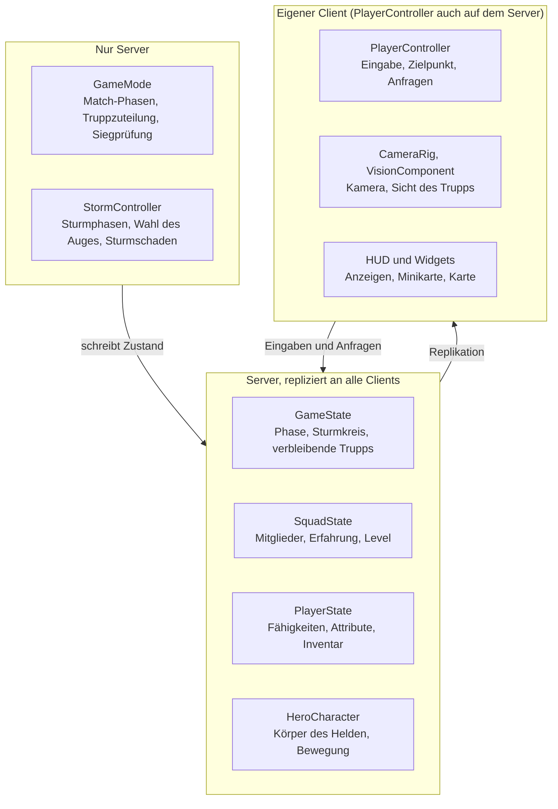

# Battle of the Storm – Technical Design Document (Prototyp)

> Quelle: [Claude Doc](https://claude.ai/artifact/X4hCCjgBEqmUoXAgdhXtM9) · Diese Datei ist eine Kopie. Änderungen bitte im Claude Doc vornehmen.

## Versionierung

Aktuelle Version: 0.1. Grundlage ist das Game Design Document (GDD) in Version 0.4. Jede inhaltliche Änderung an diesem Dokument wird hier festgehalten. Das gilt für Menschen und für Agents.

**Regeln**

1. Vor dem Speichern einer Änderung eine neue Zeile oben in die Tabelle eintragen: Version, Datum, Autor, Änderung mit betroffenen Abschnitten.
2. Versionsnummer: zweite Stelle erhöhen bei Ergänzungen und Wertänderungen, erste Stelle bei Änderungen an Grundsatzentscheidungen (Engine, Netzwerkmodell, Umfang des Prototyps).
3. „Aktuelle Version“ und die zugrunde liegende GDD-Version in der Zeile über diesen Regeln anpassen.
4. Reine Tippfehler-Korrekturen brauchen keinen Eintrag.

| Version | Datum | Autor | Änderung |
| --- | --- | --- | --- |
| 0.1 | 2026-11-12 | Claude, im Auftrag von Florian | Erste Fassung auf Basis von GDD 0.4 |

**Kennzeichnung im Dokument:** „fest“ heißt von Florian entschieden. „Vorschlag“ heißt in diesem Dokument vorgeschlagen und noch nicht bestätigt. „Annahme“ heißt aus dem GDD abgeleitet, weil eine Vorgabe fehlt.

## 1. Zweck und Geltungsbereich

Dieses Dokument legt fest, wie der Prototyp von Battle of the Storm in Unreal Engine 5 technisch gebaut wird. Das GDD beschreibt, was das Spiel ist. Dieses Dokument beschreibt, wie der erste spielbare Stand davon entsteht.

- Bei Fragen zum Spieldesign gilt das GDD. Bei Fragen zur technischen Umsetzung gilt dieses Dokument.
- Wo der Prototyp bewusst vom GDD abweicht oder vereinfacht, steht das in Abschnitt 2.
- Das Dokument gilt nur für den Prototyp. Anforderungen des fertigen Spiels (60 Spieler, Sichtsystem auf dem Server, Monetarisierung) sind nur dort genannt, wo sie Entscheidungen im Prototyp beeinflussen.

Der Prototyp soll drei Fragen beantworten:

1. Fühlt sich Heldenkampf mit WASD, Maus-Zielen und Fähigkeiten aus der Top-Down-Sicht gut an?
2. Trägt der Core Loop aus dem GDD (landen, sammeln, leveln, kämpfen, Sturm folgen) ein kurzes Match?
3. Hält die technische Basis aus Gameplay Ability System und dediziertem Server unter Latenz?

## 2. Umfang des Prototyps

Der Prototyp ist ein Match für 8 Spieler mit 4 Helden, einem Kartenbiom und 3 Sturmphasen. Diese vier Eckwerte stammen aus dem Vorschlag in GDD-Abschnitt 16. Florian hat den Umfang nicht bestätigt, der gesamte Abschnitt ist deshalb eine Annahme.

### Enthalten

| Bereich | Umfang im Prototyp | Abweichung vom GDD |
| --- | --- | --- |
| Spieler | 8 pro Match, dedizierter Server | GDD: 60 |
| Trupps | Truppgröße als Konfigurationswert. Offen: 2 Trupps à 4 oder 4 Trupps à 2 | GDD: 15 Trupps à 4 |
| Helden | 4, je einer aus 4 Rollen. Vorschlag: Kordo (Tank), Elowen (Heiler), Sefa (Fernkampf-Assassine), Kiro (Nahkampf-Assassine) | GDD: 12 |
| Fähigkeiten | Basisangriff, Fähigkeiten 1 bis 3, Merkmal, Sturmlauf, eine Ultimative Fähigkeit pro Held | GDD: Wahl aus 2 Ultimativen |
| Talente | System vollständig. Inhalt: 2 Stufen (Level 1 und 4) mit je 2 Optionen pro Held, also 16 Talente | GDD: 7 Stufen mit je 3 Optionen |
| Trupp-Level | 1 bis 10. Ultimative Fähigkeit ab Level 8 | GDD: 1 bis 20 |
| Erfahrung | Lager neutraler Kreaturen (eine Größe), besiegte Helden, Aufholbonus | Ohne Aufträge, Sturmkerne, Truhen-XP |
| Beute | Truhen und Lager. Relikte in 3 Slots, 2 Seltenheiten. 2 Aktivgegenstände: Heiltrank, Schildphiole | GDD: 4 Seltenheiten, mehr Gegenstände |
| Sturm | 3 Phasen bis Durchmesser 0, Schaden, Wirkung im Sturm | GDD: 7 Phasen, Sturm-Ereignisse |
| Niederschlag | Niederschlag, Vollenden, Wiederbelebung | Ohne Sturmsiegel und Wiederkehr |
| Match-Rahmen | Heldenwahl, Wahl des Startpunkts, Match, Siegbildschirm | Kein Gleiterflug |
| Sicht | Sichtlinie und geteilte Truppsicht, auf dem Client berechnet | GDD: auf dem Server |
| Karte | Ein Biom als Graubox, rund 440 × 440 m | GDD: 1.200 × 1.200 m, 5 Biome |
| HUD | Fähigkeitenleiste, Truppanzeige, Sturmanzeige, einfache Minikarte, Talentauswahl | Ohne Auftragsanzeige |

Kartengröße: Das GDD sieht 1.440.000 m² für 60 Spieler vor, also 24.000 m² pro Spieler. Für 8 Spieler ergibt das 192.000 m², ein Quadrat mit rund 440 m Kantenlänge.

Bei Truppgröße 4 und 4 Helden besteht jeder Trupp aus denselben vier Helden, weil das GDD jeden Helden pro Trupp nur einmal erlaubt. Eine echte Heldenwahl gibt es im Prototyp nur bei kleineren Trupps.

### Nicht enthalten

- Aufträge, Sturm-Ereignisse (Blitzfeld, Sturmfront, Sturmkern, Windschneise)
- Schreine, Sturmsplitter, Sturmsiegel, Wiederkehr
- Wachtürme, zerstörbare Deckung
- Ping-Rad, Sprachchat, Zielvorschau für Fähigkeiten
- Konten, Matchmaking, Meta-Progression, Shop, freie Rotation
- Sichtsystem auf dem Server und Schutz gegen Cheats
- Endgültige Grafik, Animationen und Audio. Der Prototyp nutzt Platzhalter.

### Abhängigkeit vom GDD

Die Fähigkeiten 1 bis 3 und die Talente der Helden fehlen im GDD (offener Punkt in Abschnitt 16). Das Kit des ersten Helden muss vor Meilenstein 2 vorliegen, seine Talente vor Meilenstein 5, Kits und Talente der anderen drei Helden vor Meilenstein 6.

## 3. Technologie-Stack

Der Prototyp nutzt Unreal Engine 5 mit C++ für die Systeme und Blueprints für die Inhalte. Alle Bausteine außer der Engine-Wahl sind Vorschläge.

| Bereich | Wahl | Status | Begründung |
| --- | --- | --- | --- |
| Engine | Unreal Engine 5 | fest | GDD-Abschnitt 14 |
| Engine-Version | Offen. Beim Projektstart festlegen und für den Prototyp nicht wechseln | offen | Versionswechsel kosten Zeit ohne Erkenntnis |
| Systemcode | C++ | Vorschlag | Replikation, Fähigkeiten-Basisklassen und Bewegungsvorhersage sind in Blueprints nicht vollständig umsetzbar |
| Inhalte | Blueprints und Daten-Assets auf C++-Basisklassen | Vorschlag | Helden, Fähigkeiten und Werte ohne Neukompilieren änderbar |
| Fähigkeiten | Gameplay Ability System (Engine-Plugin) | Vorschlag | Im GDD als Grund für die Engine-Wahl genannt |
| Eingabe | Enhanced Input (Engine-Plugin) | Vorschlag | Standard-Eingabesystem in UE5 |
| Markierungen | Gameplay Tags | Vorschlag | Zustände, Slots und Abklingzeiten ohne feste Abhängigkeiten im Code |
| Oberfläche | UMG | Vorschlag | Für den HUD-Umfang ausreichend |
| Effekte | Niagara, Platzhalter | Vorschlag | Nur für Lesbarkeit der Fähigkeiten |
| KI neutraler Kreaturen | AIController mit Behavior Tree, Navigationsnetz | Vorschlag | Verhalten ist einfach: warten, angreifen, zurückkehren |
| Netzwerk | Replikationssystem der Engine, dedizierter Server | fest (Modell), Vorschlag (Details) | GDD-Abschnitt 14 |
| Verbindung | Direkt über IP-Adresse | Vorschlag | Kein Online-Dienst nötig |
| Versionsverwaltung | Git mit Git LFS im bestehenden GitHub-Repository | Vorschlag | Repository existiert bereits |
| Plattform | Windows-PC für Client und Server | Vorschlag | GDD: PC zuerst |

**Voraussetzung für den Server:** Ein eigenständiges Server-Programm lässt sich nur mit einer aus dem Quellcode gebauten Engine erstellen. Die Engine aus dem Epic Games Launcher reicht für Tests im Editor, weil der Editor dort selbst einen dedizierten Server startet (Netzmodus „Play As Client“). Der Quellcode-Build wird erst für Meilenstein 7 gebraucht.

**Bewusst nicht genutzt:** Iris, Replication Graph, Mover-Plugin, World Partition, CommonUI, Online Subsystem. Sie lösen Probleme, die bei 8 Spielern und einer kleinen Karte nicht auftreten.

## 4. Architekturübersicht

Der Server entscheidet über jeden Spielzustand, die Clients senden Eingaben und stellen dar. Der Code liegt in einem Laufzeitmodul `BattleOfTheStorm`, alle Klassen tragen das Kürzel `BotS`.



Nur der Server führt GameMode und StormController aus. Beide schreiben in replizierte Zustände, die alle Clients erhalten. Clients senden Eingaben und Anfragen zurück, die der Server prüft.

| Klasse | Basisklasse | Läuft auf | Aufgabe |
| --- | --- | --- | --- |
| `ABotSGameMode` | `AGameModeBase` | nur Server | Match-Phasen, Truppzuteilung, Startpunkte, Siegprüfung |
| `ABotSGameState` | `AGameStateBase` | Server, repliziert an alle | Aktuelle Phase, Sturmzustand, verbleibende Trupps |
| `ABotSSquadState` | `AInfo` | Server, repliziert an alle | Mitglieder, Trupp-Erfahrung, Trupp-Level |
| `ABotSPlayerState` | `APlayerState` | Server, repliziert an alle | Heldenwahl, Trupp, Fähigkeiten-Komponente, Attribute, Inventar, gewählte Talente |
| `ABotSPlayerController` | `APlayerController` | Server und eigener Client | Eingabe, Zielpunkt, Anfragen an den Server (Talentwahl, Heldenwahl) |
| `ABotSHeroCharacter` | `ACharacter` | Server, repliziert an alle | Körper des Helden in der Welt, Bewegung, Darstellung |
| `UBotSCharacterMovementComponent` | `UCharacterMovementComponent` | Server und Clients | Bewegungsvorhersage einschließlich Sturmlauf |
| `UBotSAbilitySystemComponent` | `UAbilitySystemComponent` | Server und Clients | Fähigkeiten, Effekte, Tags |
| `ABotSStormController` | `AInfo` | nur Server | Berechnet Sturmphasen, schreibt sie in den GameState, verteilt Sturmschaden |
| `ABotSCreature` | `ACharacter` | Server, repliziert an alle | Neutrale Kreatur mit eigener Fähigkeiten-Komponente |
| `ABotSLootChest`, `ABotSPickup` | `AActor` | Server, repliziert an alle | Truhen und aufhebbare Gegenstände |
| `ABotSCameraRig` | `AActor` | nur eigener Client | Top-Down-Kamera |
| `UBotSVisionComponent` | `UActorComponent` | nur eigener Client | Sichtlinie und Truppsicht |
| `ABotSHUD` und Widgets | `AHUD`, `UUserWidget` | nur eigener Client | Oberfläche |

Grundsätze:

- Dauerhafte Daten eines Spielers liegen im `ABotSPlayerState`, nicht im Helden-Körper. Der Körper kann zerstört und neu erzeugt werden, ohne dass Level, Talente oder Abklingzeiten verloren gehen. Das hält den Weg zur Wiederkehr aus dem GDD offen.
- Trupp-Daten liegen im `ABotSSquadState`, weil das GDD ein gemeinsames Level pro Trupp vorsieht.
- Sichtberechnung ist in einer Komponente gekapselt. Der spätere Umzug auf den Server betrifft dann nur diese Stelle und die Relevanzregeln.

## 5. Netzwerk und Replikation

Ein dedizierter, autoritativer Server berechnet Schaden, Abklingzeiten, Beute, Sturm und Level. Clients sagen nur die eigene Bewegung und den Start eigener Fähigkeiten voraus.

| Thema | Umsetzung im Prototyp | Später laut GDD |
| --- | --- | --- |
| Server | Dediziert, 8 Spieler, Tickrate 30 Hz | 60 Spieler |
| Bewegung | Vorhersage und Korrektur des `UCharacterMovementComponent` | gleich |
| Sturmlauf und Tempoänderungen | Als eigener Zustand in der Bewegungsvorhersage (siehe unten) | gleich |
| Fähigkeiten | Lokal vorhergesagt gestartet, Wirkung nur auf dem Server | gleich |
| Zielpunkt | Client sendet die Weltposition des Mauszeigers mit der Aktivierung. Server prüft Reichweite | gleich |
| Projektile und Flächen | Vom Server erzeugte, replizierte Akteure. Keine Lag-Kompensation | Lag-Kompensation |
| Relevanz | Standard der Engine: Akteure jenseits von 150 m werden nicht übertragen. `PlayerState`, `SquadState` und `GameState` immer | Filter nach Sicht- und Hörweite |
| Sicht | Client blendet Gegner außerhalb der Sicht aus | Server überträgt unsichtbare Gegner nicht |
| Verbindung | Direkt über IP-Adresse, ohne Sitzungsdienst | Matchmaking |

### Bewegung und Tempoänderungen

Tempoänderungen sind das größte Vorhersage-Risiko im Prototyp. Setzt nur der Server ein neues Tempo, rechnet der Client bis zum Eintreffen mit dem alten Wert und wird sichtbar zurückgesetzt.

- Sturmlauf wird als Flag in den gespeicherten Bewegungsschritten des `UBotSCharacterMovementComponent` übertragen. Client und Server rechnen dann jeden Schritt mit demselben Tempo.
- Das Kanalisieren von 1 s vor dem Sturmlauf und das Ende bei Schaden entscheidet der Server. Der Client sagt nur den Beginn voraus.
- Verlangsamungen und Beschleunigungen durch gegnerische Effekte kommen vom Server. Kleine Korrekturen sind hier hinzunehmen. Ob sie stören, misst Meilenstein 1.

### Abweichung: keine Lag-Kompensation

Das GDD verlangt Lag-Kompensation für Projektile und Flächen. Der Prototyp lässt sie weg. Stattdessen wird mit künstlicher Latenz gemessen, ab welchem Wert Treffer als unfair empfunden werden. Das Ergebnis entscheidet über den Aufwand im fertigen Spiel.

### Bandbreite

- Der Sturm wird pro Phase einmal repliziert, nicht pro Tick (Abschnitt 9).
- Kosmetische Effekte laufen über Gameplay Cues und werden nicht als eigene Akteure repliziert.
- Die Fähigkeiten-Komponente der Helden nutzt den Replikationsmodus „Mixed“, die der Kreaturen „Minimal“. Vollständige Effektdaten erhält damit nur der eigene Client.

## 6. Helden und Fähigkeiten

Alle Kampfmechaniken laufen über das Gameplay Ability System (GAS): Jede Aktion ist eine Fähigkeit, jede Wertänderung ein Effekt, jeder Zustand ein Tag.

### Aufbau

- Die Fähigkeiten-Komponente und die Attribute eines Spielers liegen im `ABotSPlayerState`. Der Helden-Körper ist nur der Avatar. Die Aktualisierungsrate des `PlayerState` im Netz muss dafür gegenüber dem Engine-Standard erhöht werden.
- Neutrale Kreaturen tragen ihre Fähigkeiten-Komponente am eigenen Körper.
- Ein Held ist ein Daten-Asset `UBotSHeroData`: Rolle, Grundwerte, Fähigkeit je Slot, Talente je Stufe, Platzhalter-Modell. Ein neuer Held braucht keinen neuen C++-Code, solange seine Fähigkeiten aus vorhandenen Bausteinen bestehen.

### Attribute

| Attribut | Bedeutung | Quelle der Startwerte |
| --- | --- | --- |
| `Health`, `MaxHealth` | Lebenspunkte | GDD-Abschnitt 15, je Rolle |
| `HealthRegen` | Regeneration pro Sekunde | fehlt im GDD |
| `Mana`, `MaxMana`, `ManaRegen` | Ressource | fehlt im GDD |
| `Shield` | Temporärer Schild, wird vor Lebenspunkten verbraucht | durch Fähigkeiten und Gegenstände |
| `AttackDamage` | Schaden des Basisangriffs | GDD-Abschnitt 15 |
| `AttackSpeed` | Angriffe pro Sekunde | GDD-Abschnitt 15 |
| `AttackRange` | Reichweite des Basisangriffs | GDD-Abschnitt 15 |
| `MoveSpeed` | Grundtempo, 4,0 m/s | GDD-Abschnitt 9 |
| `CooldownReduction` | Verkürzung der Abklingzeiten | durch Relikte |
| `IncomingDamage`, `IncomingHealing` | Rechenwerte, nicht repliziert | Zwischenschritt für Schild, Heilungsreduktion im Sturm |

Heldeneigene Ressourcen (Geröll bei Kordo) liegen in einem zusätzlichen Attribut-Satz, den nur dieser Held erhält.

### Level-Skalierung

Lebenspunkte und Schaden steigen laut GDD um 4 % pro Level. Umsetzung: ein dauerhafter Effekt, dessen Stufe dem Trupp-Level entspricht, mit dem Faktor 1,04 hoch (Level − 1) aus einer Kurventabelle. Level 10 ergibt den Faktor 1,42. Steigt der Trupp auf, setzt der Server die Stufe des Effekts bei allen Mitgliedern neu.

### Fähigkeiten

| Baustein | Umsetzung |
| --- | --- |
| Basisklasse | `UBotSGameplayAbility` mit Slot-Tag, Kosten-Effekt, Abklingzeit-Effekt |
| Aktivierung | Eingabe-Tag je Slot. Schnellzauber: Aktivierung beim Tastendruck mit dem aktuellen Zielpunkt |
| Basisangriff | Eigene Fähigkeit, wiederholt sich bei gehaltener Maustaste im Takt von `AttackSpeed` |
| Projektile | Basisklasse `ABotSProjectile`, vom Server erzeugt, Treffer löst Effekt aus |
| Flächen | Basisklasse `ABotSAreaEffect` mit Vorwarnzeit und sichtbarem Rand (GDD-Abschnitt 11) |
| Schaden | Effekt mit Berechnungsklasse. Reihenfolge: `IncomingDamage`, dann `Shield`, dann `Health` |
| Kontrolle | Betäubung, Verlangsamung, Festhalten als Effekte mit Tag. Fähigkeiten sind über blockierende Tags gesperrt |
| Darstellung | Gameplay Cues. Farbe nach Beziehung zum Betrachter: verbündet blau, gegnerisch rot, neutral gelb |

### Tags

| Gruppe | Beispiele |
| --- | --- |
| `State.*` | `State.Downed`, `State.InStorm`, `State.Channeling`, `State.Stunned`, `State.StormRun` |
| `Ability.Slot.*` | `Ability.Slot.Basic`, `Ability.Slot.1` bis `Ability.Slot.5`, `Ability.Slot.StormRun` |
| `Cooldown.*` | Ein Tag je Slot, vom HUD ausgelesen |
| `Input.*` | Ein Tag je Eingabeaktion |
| `GameplayCue.*` | Ein Tag je sichtbarem Effekt |

### Talente

Ein Talent ist ein Daten-Asset `UBotSTalentData` und kann drei Dinge tun: eine Fähigkeit gewähren oder ersetzen, einen dauerhaften Effekt anwenden, ein Tag setzen, das eine vorhandene Fähigkeit abfragt. Damit lassen sich Talente bauen, die Fähigkeiten verändern, wie das GDD es verlangt.

Ablauf der Wahl: Der Client sendet Stufe und Option. Der Server prüft, ob das Trupp-Level erreicht und die Stufe noch offen ist, wendet das Talent an und speichert die Wahl im `PlayerState`. Das Spiel pausiert nicht.

## 7. Steuerung und Kamera

Die Belegung aus dem GDD wird mit Enhanced Input in einem Mapping-Kontext `IMC_Hero` umgesetzt. Bewegung auf WASD, Fähigkeiten auf 1 bis 5 und Aktivgegenstände auf Q und E sind fest.

| Eingabeaktion | Taste | Wirkung |
| --- | --- | --- |
| `IA_Move` | W, A, S, D | Bewegung entlang der Bildschirmachsen |
| `IA_BasicAttack` | Linke Maustaste | Basisangriff, gehalten wiederholend |
| `IA_Ability1` bis `IA_Ability3` | 1, 2, 3 | Grundfähigkeiten |
| `IA_Ability4` | 4 | Ultimative Fähigkeit |
| `IA_Ability5` | 5 | Merkmal, falls aktiv |
| `IA_StormRun` | Z | Sturmlauf |
| `IA_Item1`, `IA_Item2` | Q, E | Aktivgegenstände |
| `IA_Interact` | F | Aufheben, Truhe öffnen, Wiederbeleben |
| `IA_Map` | Tab | Karte ein- und ausblenden |
| `IA_Talent1`, `IA_Talent2` | Strg+1, Strg+2 | Talentoption wählen |

Die Zuordnung der Slots 1 bis 5 steht im GDD-Abschnitt 6. Die Belegung liegt in Daten und ist ohne Codeänderung umstellbar. Strg+1 und Strg+2 dürfen nicht zusätzlich die Fähigkeiten 1 und 2 auslösen. Das wird in Meilenstein 5 geprüft.

### Zielen

- Der Zielpunkt ist der Schnittpunkt des Mausstrahls mit einer waagerechten Ebene auf Fußhöhe des Helden. Ein Treffertest gegen die Geländegeometrie würde an Kanten und Wänden springen.
- Vorschlag: Der Held blickt dauerhaft zum Zielpunkt. Die Blickrichtung läuft über die Steuerrotation des Controllers und wird dadurch mit der Bewegung vorhergesagt und repliziert.
- Das GDD legt nicht fest, ob der Held zum Mauszeiger oder in Laufrichtung blickt. Die Alternative ist ein Schalter in den Daten.

### Kamera

- `ABotSCameraRig` existiert nur auf dem eigenen Client und folgt dem Helden. Die Kamera dreht sich nicht mit dem Helden.
- Neigung, Abstand und Sichtfeld sind feste Werte in den Daten. Das GDD nennt keine Zahlen, sie werden in Meilenstein 1 ermittelt.
- Vorlauf: Die Kamera verschiebt sich um einen begrenzten Anteil in Richtung Mauszeiger, weich nachgeführt.
- Ist der Spieler ausgeschaltet, folgt die Kamera einem lebenden Truppmitglied.

## 8. Match-Ablauf

Ein Match läuft in einer einzigen Karte ohne Ladewechsel durch fünf Zustände, die der `ABotSGameMode` steuert und der `ABotSGameState` repliziert.

1. **Warten auf Spieler.** Spieler verbinden sich. Der Server teilt sie der Reihe nach auf Trupps auf. Start bei voller Spielerzahl oder per Befehl.
2. **Heldenwahl (60 s).** Jeder Spieler wählt einen Helden. Der Server lehnt einen Helden ab, der im Trupp schon vergeben ist. Wer nicht wählt, erhält einen freien Helden.
3. **Startpunkt.** Jeder Spieler wählt auf der Karte einen Startpunkt oder folgt dem Truppführer. Danach erzeugt der Server die Helden dort. Das ersetzt den Gleiterflug aus dem GDD.
4. **Match.** Sturm, Kampf, Beute und Level laufen, bis nur ein Trupp übrig ist.
5. **Ende.** Siegbildschirm mit Platzierung. Der Server startet danach neu.

### Trupps und Sieg

- Ein `ABotSSquadState` pro Trupp hält Mitglieder, Erfahrung und Level.
- Ein Trupp ist ausgeschieden, wenn alle Mitglieder gleichzeitig niedergeschlagen oder ausgeschaltet sind (GDD-Abschnitt 10). Der Server prüft das bei jedem Niederschlag und jedem Ausschalten.
- Sieger ist der letzte Trupp. Scheiden die letzten Trupps im selben Server-Tick aus, gewinnt der Trupp, dessen letztes Mitglied zuletzt Schaden erlitten hat. Das GDD regelt diesen Fall nicht, die Regel ist ein Vorschlag.
- Trennt ein Spieler die Verbindung, gilt sein Held als ausgeschaltet. Ein Wiedereinstieg ist im Prototyp nicht vorgesehen.

### Niederschlag und Wiederbelebung

| Zustand | Auslöser | Umsetzung |
| --- | --- | --- |
| Niedergeschlagen | Lebenspunkte auf 0 | Tag `State.Downed`, Fähigkeiten gesperrt, Kriechtempo, Ausbluten über 30 s als Effekt |
| Wiederbelebt | Truppmitglied hält F 5 s in der Nähe | Kanalisierte Fähigkeit, durch Schaden oder Bewegung unterbrochen. Rückkehr mit 30 % Lebenspunkten. Im Sturm 10 s |
| Ausgeschaltet | Ausbluten abgelaufen oder Gegner vollendet durch Schaden | Held wird entfernt und lässt seine Gegenstände fallen. Spieler schaut dem Trupp zu |

Dauer, Tempo und Lebenspunkte nach der Wiederbelebung stehen in den Daten. Dass ausgeschaltete Helden ihre Gegenstände fallen lassen, ist ein Vorschlag. Das GDD sagt nur, dass Rückkehrer keine Relikte haben.

### Trupp-Erfahrung

- Quellen im Prototyp: Lager neutraler Kreaturen und besiegte Helden. Die Erfahrung geht an den Trupp, nicht an den einzelnen Spieler.
- Aufholbonus aus dem GDD: 15 % mehr Erfahrung pro Level Unterschied, wenn der besiegte Trupp ein höheres Level hat.
- Die Erfahrung je Level steht in einer Kurventabelle. Das GDD nennt keine Werte. Sie werden so gesetzt, dass ein Trupp Level 8 vor Ende der zweiten Sturmphase erreichen kann.
- Bei einem Aufstieg setzt der Server die Level-Skalierung aller Mitglieder neu und schaltet fällige Talentstufen frei.

## 9. Sturmring

Der Server berechnet den Sturm und überträgt pro Phase nur Start- und Zielkreis mit Zeitstempeln. Die Clients errechnen den aktuellen Kreis daraus selbst.

### Phasen im Prototyp

Die ersten drei Phasen aus dem GDD schließen die Zone nicht. Der Prototyp braucht eigene Werte, die bei Durchmesser 0 enden. Die folgenden Startwerte sind ein Vorschlag für die Karte mit 440 m Kantenlänge.

| Phase | Wartezeit (s) | Schrumpfen (s) | Durchmesser danach (m) | Schaden pro s (% max. LP) |
| --- | --- | --- | --- | --- |
| 1 | 120 | 90 | 220 | 2 |
| 2 | 90 | 60 | 90 | 5 |
| 3 | 60 | 45 | 0 | 12 |

Der Sturm läuft damit 465 s, also 7 min 45 s. Zu Beginn umschließt der Kreis die ganze Karte (Durchmesser rund 620 m, die Diagonale des Quadrats). Die Werte stehen in einer Datentabelle mit einer Zeile pro Phase. Die 7 Phasen des GDD lassen sich später ohne Codeänderung eintragen.

### Ablauf einer Phase

1. Zu Beginn der Wartezeit wählt der Server das nächste Auge zufällig so, dass es vollständig im aktuellen Kreis liegt.
2. Der Server schreibt in den `ABotSGameState`: Phasennummer, Mittelpunkt und Radius des aktuellen Kreises, Mittelpunkt und Radius des Auges, Startzeit und Endzeit des Schrumpfens in Server-Zeit.
3. Während des Schrumpfens wandern Mittelpunkt und Radius linear vom aktuellen Kreis zum Auge. Server und Clients rechnen mit derselben Formel und der synchronisierten Server-Zeit.
4. Nach dem Schrumpfen beginnt die nächste Phase. Nach der letzten Phase bleibt der Radius 0.

### Schaden und Wirkung

- Der Server prüft einmal pro Sekunde für jeden Helden, ob er außerhalb des aktuellen Kreises steht. Wer außerhalb steht, trägt das Tag `State.InStorm` und einen periodischen Effekt.
- Der Effekt zieht pro Sekunde den Prozentsatz der Phase von `MaxHealth` ab. Schilde werden dabei nicht umgangen. Ob Schilde Sturmschaden abfangen sollen, regelt das GDD nicht.
- Wirkung im Sturm laut GDD, jeweils an `State.InStorm` geknüpft: keine Lebensregeneration, Heilung um 50 % reduziert, Wiederbelebung dauert doppelt so lange, Sichtweite halbiert.

### Darstellung

- Sturmwand: ein Zylinder mit Platzhalter-Material, den der Client auf den errechneten Kreis skaliert. Der Rand der Zone muss immer klar erkennbar sein (GDD-Abschnitt 13).
- Minikarte und Karte zeigen den aktuellen Kreis und das Auge.
- Oben in der Mitte stehen Phase und Zeit bis zum nächsten Schrumpfen.

## 10. Beute und Gegenstände

Gegenstände sind Daten-Assets, die über das Gameplay Ability System wirken: Ein Relikt ist ein dauerhafter Effekt, ein Aktivgegenstand eine gewährte Fähigkeit mit Ladungen.

| Baustein | Umsetzung |
| --- | --- |
| Gegenstand | `UBotSItemData`: Typ (Relikt Angriff, Verteidigung, Nutzen oder Aktivgegenstand), Seltenheit, Effekt oder Fähigkeit, Symbol |
| Inventar | `UBotSInventoryComponent` am `PlayerState`. 3 Relikt-Slots, einer je Typ, und 2 Aktiv-Slots. Repliziert an den Besitzer |
| Aufheben | F in Reichweite. Der Server prüft Abstand und Slot. Ist der Slot belegt, fällt der alte Gegenstand zu Boden |
| Truhe | `ABotSLootChest`, einmal zu öffnen. Der Server würfelt aus einer gewichteten Beutetabelle und erzeugt `ABotSPickup`-Akteure |
| Lager | Kreaturen geben beim Tod Trupp-Erfahrung und würfeln aus einer eigenen Beutetabelle |
| Relikt anlegen | Der Server wendet den Effekt an, beim Ablegen entfernt er ihn |
| Aktivgegenstand nutzen | Q oder E aktiviert die gewährte Fähigkeit. Ladungen zählt das Inventar |

### Inhalt im Prototyp

| Gegenstand | Typ | Wirkung |
| --- | --- | --- |
| Relikt Angriff | passiv | Ein Wert aus: Schaden, Angriffstempo, Abklingzeit |
| Relikt Verteidigung | passiv | Ein Wert aus: Lebenspunkte, Schild bei Kampfbeginn |
| Relikt Nutzen | passiv | Ein Wert aus: Tempo, schnellere Wiederbelebung |
| Heiltrank | aktiv | Heilt über kurze Zeit |
| Schildphiole | aktiv | Gewährt einen temporären Schild |

Relikte gibt es in den Seltenheiten Gewöhnlich und Selten. Zahlenwerte für Gegenstände fehlen im GDD und werden beim Bau in den Daten gesetzt.

### Neutrale Kreaturen

- Eine Lagergröße mit 2 bis 3 Kreaturen. Verhalten: am Lager warten, Helden in Reichweite angreifen, bei zu großer Entfernung zurückkehren und Lebenspunkte auffüllen.
- Kreaturen nutzen dieselbe Schadensberechnung wie Helden.
- Kein Wiedererscheinen im Prototyp. Der Schalter dafür steht in den Daten.

## 11. Karte und Level

Die Prototyp-Karte ist eine Graubox von rund 440 × 440 m in einem einzigen Level, ohne World Partition. Maßeinheit der Engine ist der Zentimeter: 1 m aus dem GDD entspricht 100 Einheiten.

| Merkmal | Festlegung | Herleitung |
| --- | --- | --- |
| Größe | rund 440 × 440 m | Gleiche Fläche pro Spieler wie im GDD (Abschnitt 2) |
| Biom | Vorschlag: Ruinenstadt | Deckt Sichtlinien, Engstellen und Nahkampf ab. Offen |
| Truhen | 16 | GDD: 120 für 60 Spieler, also 2 pro Spieler |
| Lager | 4 | GDD: 30 für 60 Spieler, also 1 pro 2 Spieler |
| Startpunkte | mindestens 8, verteilt | Wahl in der Startpunkt-Phase |
| Geometrie | Einfache Grundkörper, keine endgültigen Modelle | Prototyp prüft Spielgefühl, nicht Grafik |
| Navigation | Statisches Navigationsnetz | Nur für neutrale Kreaturen |

Ein Held überquert die Karte mit Sturmlauf (5,6 m/s) in rund 80 s.

### Kollision

| Kanal | Zweck |
| --- | --- |
| Bewegung | Standard der Engine für Helden und Kreaturen |
| `Projectile` | Projektile treffen Helden, Kreaturen und Wände |
| `VisionBlocker` | Wände und Klippen blockieren die Sichtlinie |

### Sicht

- `UBotSVisionComponent` prüft auf dem Client 10-mal pro Sekunde für jeden gegnerischen Helden und jede Kreatur: Liegt das Ziel in Sichtweite eines lebenden Truppmitglieds und ist die Linie auf dem Kanal `VisionBlocker` frei?
- Nicht sichtbare Gegner und ihre Effekte werden ausgeblendet. Ein dargestellter Nebel des Krieges entfällt im Prototyp.
- Im Sturm halbiert sich die Sichtweite des betroffenen Helden.
- Die Sichtweite fehlt im GDD. Sie wird in Meilenstein 6 ermittelt und steht in den Daten.
- Einschränkung: Der Client kennt die Positionen aller Gegner im Relevanzbereich. Das ist für interne Tests vertretbar und für das fertige Spiel nicht.

## 12. Benutzeroberfläche

Die Oberfläche besteht aus UMG-Widgets, die auf Änderungen reagieren statt jeden Frame Werte abzufragen. Die Anordnung folgt GDD-Abschnitt 11.

| Widget | Position | Inhalt | Datenquelle |
| --- | --- | --- | --- |
| `WBP_AbilityBar` | unten Mitte | Slots 1 bis 5, Sturmlauf, Abklingzeiten, Lebenspunkte, Mana, Aktivgegenstände | Attribute und Abklingzeit-Tags der eigenen Fähigkeiten-Komponente, Inventar |
| `WBP_SquadFrames` | unten links | Lebenspunkte und Status der Truppmitglieder, Trupp-Level | `PlayerState` der Mitglieder, `SquadState` |
| `WBP_StormStatus` | oben Mitte | Phase, Zeit bis zum Schrumpfen, verbleibende Trupps und Spieler | `GameState` |
| `WBP_Minimap` | oben rechts | Kartenbild, eigener Trupp, aktueller Kreis, Auge | `GameState`, Positionen des Trupps |
| `WBP_TalentChoice` | Mitte | Offene Talentstufe mit 2 Optionen | `SquadState`, `PlayerState` |
| `WBP_Map` | Vollbild auf Tab | Wie Minikarte, größer | wie Minikarte |
| `WBP_HeroSelect` | Vollbild | Helden, Rollen, fehlende Rollen im Trupp, Countdown | `GameState`, `PlayerState` |
| `WBP_SpawnSelect` | Vollbild | Karte mit Startpunkten | `GameState` |
| `WBP_MatchEnd` | Vollbild | Sieg oder Platzierung | `GameState` |
| Lebensbalken | über Helden und Kreaturen | Lebenspunkte, Schild, Farbe nach Beziehung | Attribute des Ziels |

- Das Kartenbild der Minikarte ist eine einmal aufgenommene Draufsicht der Graubox.
- Lebenspunkte gegnerischer Helden kommen über replizierte Attribute beim Client an. Abklingzeiten und Mana von Gegnern werden nicht übertragen.
- Texte liegen in einer Texttabelle, damit eine spätere Übersetzung keine Widgets anfasst. Sprache des Prototyps: offen.

## 13. Daten und Konfiguration

Kein Balancing-Wert steht im C++-Code oder in einer Fähigkeiten-Logik. Jeder Wert aus dem GDD hat genau einen Ort in den Daten.

| Daten | Form | Inhalt | Quelle im GDD |
| --- | --- | --- | --- |
| Held | Daten-Asset `DA_Hero_<Name>` | Rolle, Grundwerte, Fähigkeit je Slot, Talente je Stufe | Abschnitte 5, 6, 15 |
| Rollenwerte | Datentabelle `DT_RoleStats` | Lebenspunkte, Schaden, Angriffe pro s, Reichweite je Rolle | Abschnitt 15 |
| Talent | Daten-Asset `DA_Talent_<Name>` | Stufe, Wirkung, Text, Symbol | Abschnitt 6 |
| Level-Skalierung | Kurventabelle `CT_LevelScaling` | Faktor je Level, 1,04 hoch (Level − 1) | Abschnitt 15 |
| Erfahrung | Kurventabelle `CT_SquadXP` | Erfahrung je Level, Werte je Quelle, Aufholbonus | Abschnitt 7 |
| Sturm | Datentabelle `DT_StormPhases` | Wartezeit, Schrumpfzeit, Durchmesser, Schaden je Phase | Abschnitt 4 |
| Gegenstand | Daten-Asset `DA_Item_<Name>` | Typ, Seltenheit, Effekt oder Fähigkeit | Abschnitt 7 |
| Beute | Datentabelle `DT_Loot_<Quelle>` | Gegenstand und Gewicht | Abschnitt 7 |
| Match-Regeln | Daten-Asset `DA_MatchRules` | Spielerzahl, Truppgröße, Dauer der Heldenwahl, Werte für Niederschlag und Wiederbelebung | Abschnitte 3, 10 |
| Bewegung und Kamera | Daten-Asset `DA_Tuning` | Grundtempo, Sturmlauf-Tempo und Kanalisierzeit, Kameraneigung, Abstand, Vorlauf, Sichtweite | Abschnitt 9 |
| Eingabe | `IMC_Hero` und Eingabeaktionen | Tastenbelegung | Abschnitt 9 |

- Spielerzahl und Truppgröße sind Werte in `DA_MatchRules`. Der Wechsel zwischen 2 Trupps à 4 und 4 Trupps à 2 braucht keinen neuen Build.
- Ändert sich ein Wert im GDD, wird er an genau dieser Stelle nachgezogen. Weicht der Prototyp bewusst ab, steht das in Abschnitt 2 oder 9 dieses Dokuments.

## 14. Projektstruktur, Versionsverwaltung und Build

Das Unreal-Projekt liegt im Wurzelverzeichnis des Repositorys `flobiwankenobi/battle-of-the-storm`, neben dem Ordner `docs`. Das Repository enthält bisher nur `CLAUDE.md` und `docs/GDD.md` auf dem Branch claude/project-thread-t8w3k7. Einen Branch main gibt es nicht.

```text
BattleOfTheStorm.uproject
Config/
Source/
  BattleOfTheStorm/
    Core/        GameMode, GameState, PlayerState, SquadState, PlayerController
    Character/   HeroCharacter, Bewegungskomponente, Kamera
    Abilities/   Fähigkeiten-Komponente, Attribute, Basisklassen, Berechnungen
    Match/       Match-Phasen, Niederschlag, Erfahrung
    Storm/       StormController
    Items/       Inventar, Truhen, Gegenstände
    AI/          Kreaturen
    Vision/      Sichtkomponente
    UI/          HUD, Widget-Basisklassen
  BattleOfTheStorm.Target.cs
  BattleOfTheStormEditor.Target.cs
  BattleOfTheStormServer.Target.cs
Content/
  BotS/
    Heroes/  Abilities/  Items/  Creatures/  Maps/  UI/  Data/  FX/  Input/
docs/
```

### Benennung

| Art | Präfix | Beispiel |
| --- | --- | --- |
| Blueprint | `BP_` | `BP_Hero_Kordo` |
| Fähigkeit | `GA_` | `GA_Kordo_Ability1` |
| Effekt | `GE_` | `GE_StormDamage` |
| Gameplay Cue | `GC_` | `GC_Storm_Enter` |
| Daten-Asset | `DA_` | `DA_Hero_Kordo` |
| Datentabelle, Kurventabelle | `DT_`, `CT_` | `DT_StormPhases` |
| Widget | `WBP_` | `WBP_AbilityBar` |
| Eingabe | `IA_`, `IMC_` | `IA_Move` |

Bezeichner im Code und in Assets sind englisch. Der C++-Code folgt dem Coding Standard von Epic.

### Versionsverwaltung

- Ein Hauptbranch `main` wird angelegt. Arbeit läuft über Branches und Pull Requests.
- `.uasset` und `.umap` liegen in Git LFS. Diese Dateien sind binär und lassen sich nicht zusammenführen. Zwei Personen dürfen dieselbe Datei nicht gleichzeitig ändern.
- Nicht versioniert: `Binaries/`, `Intermediate/`, `Saved/`, `DerivedDataCache/`.
- Das LFS-Kontingent des GitHub-Kontos ist nicht geprüft. Reicht es nicht, ist ein anderer LFS-Speicher oder Perforce die Alternative.

### Build

| Ziel | Zweck | Benötigt |
| --- | --- | --- |
| Editor | Tägliche Arbeit, Tests mit mehreren Clients im Editor | Engine aus dem Launcher genügt |
| Client | Eigenständiges Spiel für Windows, verbindet sich mit dem Server | Engine aus dem Launcher genügt |
| Server | Eigenständiger dedizierter Server für Windows | Engine aus dem Quellcode |

Eine automatische Build-Pipeline ist nicht Teil des Prototyps. Builds entstehen von Hand auf einem Entwicklerrechner.

## 15. Leistungsziele

Der Prototyp muss mit 8 Spielern bei 100 ms Latenz flüssig spielbar sein und Messwerte für die Hochrechnung auf 60 Spieler liefern. Alle Zielwerte außer der Tickrate sind Vorschläge.

| Messgröße | Ziel | Status |
| --- | --- | --- |
| Server-Tickrate | 30 Hz stabil mit 8 Spielern | GDD-Abschnitt 14 |
| Bildrate Client | 60 Bilder pro Sekunde bei 1920 × 1080 | Vorschlag. Referenzrechner offen |
| Spielbar bei Latenz | 100 ms Hin- und Rückweg, 1 % Paketverlust | Vorschlag |
| Rechenzeit des Servers pro Tick | Wird gemessen, kein Zielwert | Grundlage für die Hochrechnung |
| Bandbreite pro Client | Wird gemessen, kein Zielwert | Grundlage für die Hochrechnung |

Ein Ergebnis mit 8 Spielern beweist nicht, dass 60 Spieler funktionieren. Es zeigt, wie viel Rechenzeit und Bandbreite ein Spieler kostet. Die Spielerzahl aus dem GDD bleibt bis zu einem eigenen Lasttest offen.

## 16. Tests und Qualitätssicherung

Getestet wird auf drei Ebenen: automatische Tests für Rechenlogik, Mehrspieler-Tests im Editor mit künstlicher Latenz, Spieltests mit dem eigenständigen Server.

| Ebene | Werkzeug | Gegenstand |
| --- | --- | --- |
| Rechenlogik | Automatisierungstests der Engine | Sturmkreis zu einem Zeitpunkt, Wahl des Auges innerhalb des Kreises, Erfahrung und Level mit Aufholbonus, Schadensreihenfolge Schild vor Lebenspunkten, gewichtete Beute |
| Mehrspieler im Editor | Mehrere Clients mit dediziertem Server im Editor, Netzwerk-Emulation des Editors | Jede Fähigkeit bei 0 ms und bei 100 ms, Sturmlauf, Niederschlag und Wiederbelebung |
| Spieltest | Eigenständiger Server und Clients | Ganzes Match mit 8 Teilnehmern |
| Messung | Statistik-Anzeigen und Profiler der Engine | Tickzeit des Servers, Bandbreite, Bildrate |

### Test-Bots

Ein Match mit 8 Teilnehmern setzt 8 Menschen voraus. Vorschlag: einfache Bots, die einen Helden steuern, zum Auge laufen und Gegner in Reichweite mit Basisangriff und Fähigkeiten angreifen. Sie füllen freie Plätze und erzeugen Last. Sie sind kein Spielinhalt.

### Regeln

- Jede Fähigkeit gilt erst als fertig, wenn sie mit zwei Clients bei 100 ms geprüft ist.
- Jeder Meilenstein endet mit einem Spieltest gegen sein Abnahmekriterium (Abschnitt 17).
- Jeder Bereich aus Abschnitt 14 hat eine eigene Log-Kategorie. Der Server protokolliert Phasenwechsel, Niederschläge, Level-Aufstiege und abgelehnte Client-Anfragen.

## 17. Meilensteine

Der Prototyp entsteht in 8 Meilensteinen, die aufeinander aufbauen und jeweils spielbar enden. Zeitangaben fehlen, weil Teamgröße und verfügbare Zeit nicht bekannt sind.

| Nr. | Meilenstein | Inhalt | Abnahmekriterium |
| --- | --- | --- | --- |
| 0 | Projektgrundlage | Unreal-Projekt im Repository, Modul, Git LFS, leere Testkarte, Start mit dediziertem Server im Editor | Zwei Clients verbinden sich im Editor mit dem Server und sehen einander |
| 1 | Bewegung und Kamera | WASD, Zielen, Blickrichtung, Kamera mit Vorlauf, Sturmlauf mit Vorhersage | Bei 100 ms keine sichtbaren Korrekturen beim Laufen und beim Sturmlauf |
| 2 | Kampfkern | Fähigkeiten-System, Attribute, Schaden, Basisangriff, ein Held mit Fähigkeiten 1 bis 3, Fähigkeitenleiste | Zwei Spieler kämpfen bis 0 Lebenspunkte. Beide Clients zeigen dieselben Werte |
| 3 | Trupp und Niederschlag | Trupps, Truppanzeige, Niederschlag, Vollenden, Wiederbelebung, Siegprüfung | Ein Match endet korrekt, wenn ein Trupp ausgeschieden ist |
| 4 | Sturm | 3 Phasen, Schaden, Wirkung im Sturm, Sturmwand, Anzeige, Minikarte | Kreis auf Server und Clients stimmt überein. Das Match endet spätestens durch den Sturm |
| 5 | Level und Beute | Trupp-Erfahrung, Level-Skalierung, Talente, Kreaturen, Truhen, Relikte, Aktivgegenstände | Ein Trupp erreicht Level 8 im Match und nutzt die Ultimative Fähigkeit |
| 6 | Vier Helden und Match-Rahmen | Helden 2 bis 4, Heldenwahl, Startpunkt-Wahl, Sicht, Karte als Graubox, Siegbildschirm, Test-Bots | Ein vollständiges Match läuft im Editor von der Heldenwahl bis zum Siegbildschirm |
| 7 | Spieltest | Eigenständiger Server, Match mit 8 Teilnehmern, Messungen aus Abschnitt 15 | Ein Match ohne Absturz. Messwerte und Antworten auf die drei Fragen aus Abschnitt 1 liegen vor |

Abhängigkeiten außerhalb der Technik: Meilenstein 2 braucht das Kit des ersten Helden, Meilenstein 5 seine Talente, Meilenstein 6 die Kits und Talente der anderen drei Helden. Meilenstein 7 braucht die Engine aus dem Quellcode.

## 18. Risiken und offene Entscheidungen

Das größte Risiko liegt außerhalb der Technik: Die Kits der Helden fehlen, und ohne sie ist der Kampfkern nicht baubar.

### Risiken

| Risiko | Folge | Gegenmaßnahme |
| --- | --- | --- |
| Kits und Talente der 4 Helden fehlen im GDD | Meilensteine 2, 5 und 6 blockiert | Kits für die Prototyp-Helden zuerst im GDD ausarbeiten |
| Teamgröße und Unreal-Erfahrung unbekannt | Kein Zeitplan möglich. Der Umfang kann zu groß sein | Umfang nach Meilenstein 2 anhand des tatsächlichen Tempos prüfen |
| Einarbeitung in das Gameplay Ability System | Langsamer Start, Fehler in der Vorhersage | Meilenstein 2 mit nur einem Helden. Basisklassen vor den Inhalten |
| Tempoänderungen erzeugen Korrekturen | Bewegung fühlt sich bei Latenz ruckartig an | Sturmlauf in der Bewegungsvorhersage. Messung in Meilenstein 1 |
| Keine Lag-Kompensation | Treffer wirken bei Latenz unfair | Bewusst gemessen statt gelöst (Abschnitt 5) |
| Sicht auf dem Client | Späterer Umzug auf den Server ändert die Relevanzregeln | Sicht in einer Komponente gekapselt |
| Server-Build braucht die Engine aus dem Quellcode | Zusätzlicher Einrichtungsaufwand, viel Speicherplatz und Bauzeit | Erst zu Meilenstein 7 nötig. Früh einplanen |
| Git LFS-Kontingent | Repository nimmt keine Assets mehr an | Kontingent vor Meilenstein 0 prüfen |
| 8 Spieler sagen wenig über 60 | Falsche Sicherheit bei der Spielerzahl | Kosten pro Spieler messen. Eigener Lasttest nach dem Prototyp |

### Offene Entscheidungen

- [ ] Umfang des Prototyps bestätigen oder ändern (Abschnitt 2)
- [ ] Truppaufteilung: 2 Trupps à 4 oder 4 Trupps à 2
- [ ] Auswahl der 4 Helden bestätigen (Vorschlag: Kordo, Elowen, Sefa, Kiro)
- [ ] Biom der Prototyp-Karte (Vorschlag: Ruinenstadt)
- [ ] Engine-Version festlegen
- [ ] Wer entwickelt: Teamgröße, Erfahrung mit Unreal und C++, verfügbare Zeit
- [ ] Blickrichtung des Helden: dauerhaft zum Mauszeiger oder in Laufrichtung
- [ ] Fangen Schilde Sturmschaden ab
- [ ] Lassen ausgeschaltete Helden ihre Gegenstände fallen
- [ ] Referenzrechner für das Bildraten-Ziel
- [ ] Ablage dieses Dokuments: Kopien im Repository und in Dropbox wie beim GDD
